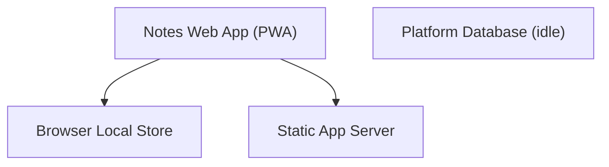
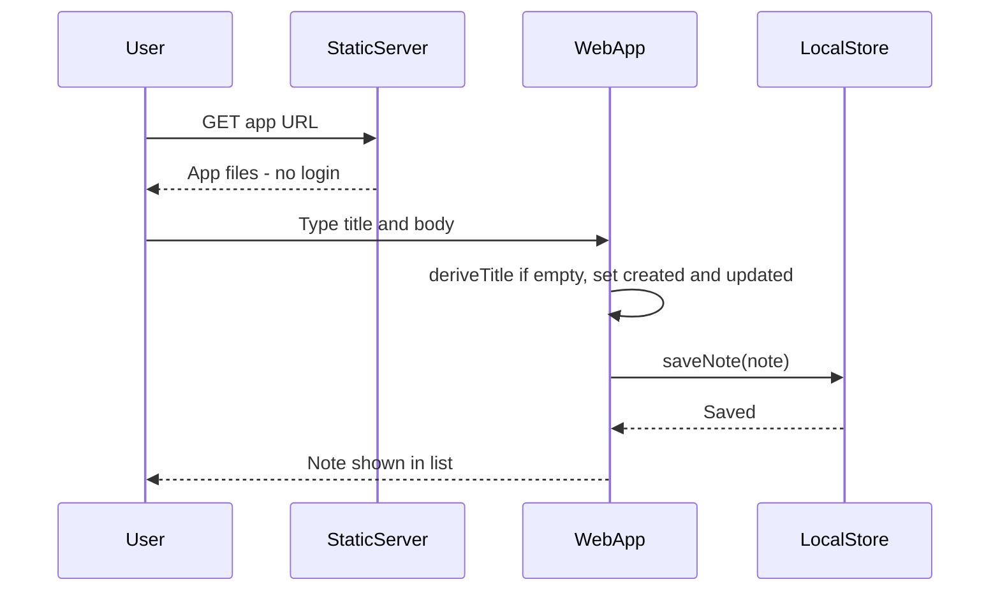
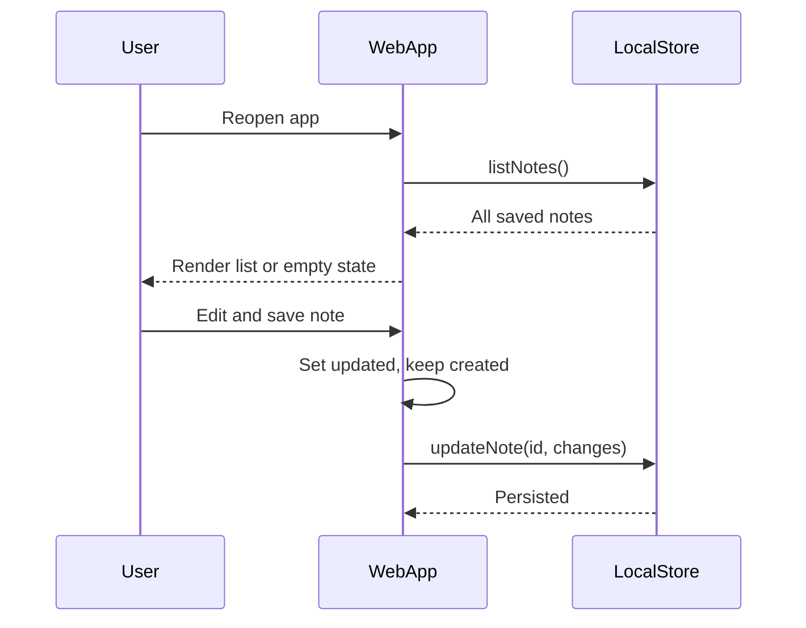
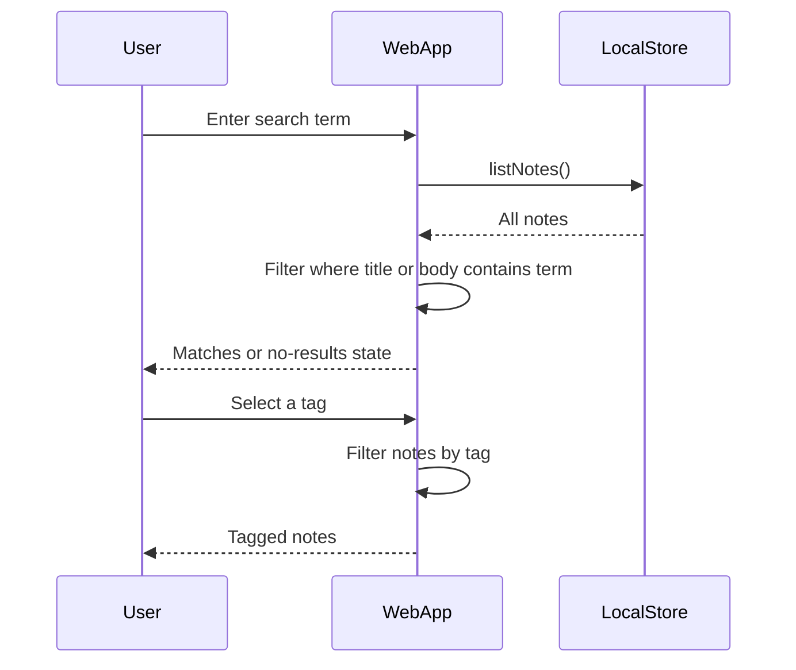
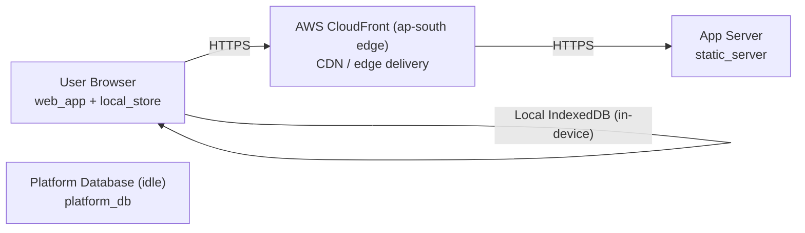

# Architecture

> Maintained by QuorQ AI SDLC. Text between `sdlc:auto` markers is regenerated; anything outside them is yours and is kept.

<!-- sdlc:auto:start narrative -->
## Overview

### ARCH-001 · approved · source: architecture:summary

Login-free, browser-only notes app: Next.js 15 frontend is the whole product, storing notes (title, body, tags, timestamps) in browser IndexedDB with client-side full-text search and tag filtering. No note data ever reaches a server.

Architecture v1, status approved. Key points: (1) No server API for note data -- IndexedDB is the sole store. (2) Express 5 server's only job is serving built app files; PostgreSQL 16 is provisioned by the platform but idle/unused. (3) Hosting on AWS, served from an edge location close to Indian users for fast mobile loads. (4) Compliance assumption: because no personal data reaches a server, India's DPDP server-side obligations (consent/notice, breach notification, residency) are treated as not triggered -- flagged explicitly as an assumption to validate, not a confirmed compliance conclusion.

**Related:** US-001

### ARCH-002 · approved · source: architecture:components

Four components: the Next.js web app (UI + note logic), the browser's IndexedDB local store (source of truth for notes), a static Express server (file serving only), and an idle PostgreSQL platform database reserved for future use.

- web_app (Notes Web App / PWA, Next.js 15): renders login-free responsive UI; handles create/edit/delete, list, client-side full-text search, free-form tags and tag filtering; manages created/last-updated timestamps; shows help and a device-only-storage notice.
- local_store (Browser Local Store, IndexedDB): persists all notes and tags on the user's device between visits; no copy sent to any server; source of truth for all note data.
- static_server (Static App Server, Express 5): serves built application files (HTML, JS, CSS, PWA manifest, service worker) to the browser; processes/stores no note data.
- platform_db (Platform Database, idle, PostgreSQL 16): standard platform-provisioned database, unused by this app since all data stays in-browser; reserved for a future sync/backup feature, explicitly out of scope now.

**Related:** US-001

### ARCH-003 · approved · source: architecture:critical_paths

Three critical user paths: instant first-open note creation with no login, persistence/listing/editing of notes across visits via IndexedDB, and client-side search plus tag filtering.

1. Instant open and create a note: first-time user opens the app URL, app loads directly into a usable editor with no login; user types title/body; note saves to IndexedDB with automatic created and last-updated timestamps. A note with body but no title still saves; typed markup is stored and shown as plain text (not rendered as formatting).
2. Persist, list and edit across visits: on return to the app on the same device/browser, saved notes load from IndexedDB into the list; opening a note and saving an edit updates body/title and sets last-updated while created stays unchanged.
3. Search notes and filter by tag: entering a search term filters the list to notes whose title or body contains the term, with a no-results state and a clear-to-reset behavior; selecting a free-form tag filters the list to notes carrying that tag; deleted notes are removed from list, search, and tag results.

**Related:** US-001

### ARCH-004 · approved · source: architecture:entities

Single data entity: note, with id, title, body, tags, created_at and updated_at fields, stored entirely client-side in IndexedDB.

Entity note: id, title, body, tags, created_at, updated_at. No other entities defined; this is the sole persisted data shape for the app, held in the browser's local store (no server-side schema).

### ARCH-005 · approved · source: architecture:endpoints

Only two HTTP endpoints exist, both served by the static Express server; neither handles note data.

- GET /healthz: liveness probe for the static app server.
- GET /*: serves the built Next.js app files, PWA manifest and service worker to the browser; no note data is handled server-side.

### ARCH-006 · approved · source: architecture:deployment_nodes

Deployment spans a CDN edge layer, a thin Node/Express app server, the user's browser (running the PWA and IndexedDB), and an idle managed Postgres instance.

- AWS CloudFront (ap-south edge): CDN / edge delivery.
- App Server: static_server component, Node.js 20 / Express 5, hosted on AWS App Runner or ECS.
- User Browser: web_app + local_store components, requires a modern mobile/desktop browser with IndexedDB and service worker support.
- Platform Database (idle): platform_db component, Amazon RDS for PostgreSQL 16, provisioned but unused by this app.

### ARCH-007 · approved · source: architecture:technology_decisions

Technology choices: Next.js 15 frontend, Express 5 static server, PostgreSQL 16 (idle, future-proofing), AWS for edge-local hosting in India -- each with alternatives considered.

- Frontend: Next.js 15 (alternatives considered: Vite + React SPA, Remix). Hosts the entire product UI, client-side note logic, and PWA shell as a single React codebase; renders a usable editor immediately on first load with no auth gate (US-001).
- Backend: Express 5 (alternatives considered: static file host only, Fastify). A thin Node server whose only job is serving the built app files, keeping one JavaScript codebase/skill set.
- Database: PostgreSQL 16 (alternatives considered: SQLite, None). Provisioned as the platform standard and the natural home should accounts/sync/backup ever be added later; currently idle.
- Cloud: AWS (alternatives considered: Cloudflare Pages, Vercel). Serves the static app from edge locations close to users in India for fast mobile loads and fits a free app's budget at this scale.

**Related:** US-001
<!-- sdlc:auto:end narrative -->

<!-- sdlc:auto:start building-blocks -->
## Building Block View

| ID | Name | Technology | Responsibility | Depends on |
|---|---|---|---|---|
| web_app | Notes Web App (PWA) | Next.js 15 | Renders the login-free, responsive note-taking UI; handles create/edit/delete, list, client-side full-text search, free-form tags and tag filtering; manages created/last-updated timestamps; shows help and the device-only-storage notice. | local_store, static_server |
| local_store | Browser Local Store | Browser IndexedDB | Persists all notes and tags on the user's device between visits; no copy is sent to any server. Source of truth for all note data. | — |
| static_server | Static App Server | Express 5 | Serves the built application files (HTML, JS, CSS, PWA manifest, service worker) to the browser. No note data is processed or stored. | — |
| platform_db | Platform Database (idle) | PostgreSQL 16 | Standard database the platform provisions. Not used by this app because all data stays in the browser; reserved for a future sync/backup feature which is out of scope now. | — |

<!-- sdlc:auto:end building-blocks -->

<!-- sdlc:auto:start runtime -->
## Runtime View

### Instant open and create a note

First-time user opens the app URL, the app loads directly into a usable editor with no login, user types a title/body, and the note is saved to IndexedDB with automatic created and last-updated timestamps. A note with body but no title is still saved; typed markup is stored and shown as plain text.

- **Components:** web_app, static_server, local_store
- **Modules:** app/page.tsx (notes shell), components/NoteEditor, lib/db (Dexie), lib/notes-repository
- **Key functions:** loadApp(), createNote(title, body, tags), deriveTitle(body), saveNote(note), setTimestamps(note)

### Persist, list and edit across visits

On return to the app on the same device and browser, saved notes load from IndexedDB into the list. Opening a note and saving an edit updates the body/title and sets last-updated while keeping created unchanged.

- **Components:** web_app, local_store
- **Modules:** components/NoteList, components/NoteEditor, lib/notes-repository
- **Key functions:** listNotes(), getNote(id), updateNote(id, changes), touchUpdatedAt(note)

### Search notes and filter by tag

User enters a search term and the list shows only notes whose title or body contains the term, with a no-results state and a clear-to-reset behaviour. Selecting a free-form tag filters the list to notes carrying that tag. Deleted notes are removed from list, search and tag results.

- **Components:** web_app, local_store
- **Modules:** components/SearchBar, components/TagFilter, lib/search, lib/notes-repository
- **Key functions:** searchNotes(term), filterByTag(tag), clearSearch(), deleteNote(id)

<!-- sdlc:auto:end runtime -->

<!-- sdlc:auto:start deployment-view -->
## Deployment View

| Name | Service | Runtime | Scaling | Environment |
|---|---|---|---|---|
| AWS CloudFront (ap-south edge) | CDN / edge delivery | AWS CloudFront | Managed edge, auto | dev |
| App Server | static_server | Node.js 20 / Express 5 (AWS App Runner or ECS) | 1 small instance (file serving only) | dev |
| User Browser | web_app + local_store | Modern mobile/desktop browser with IndexedDB and service worker | Per-device | dev |
| Platform Database (idle) | platform_db | Amazon RDS for PostgreSQL 16 | Smallest instance, idle | dev |

| Source | Target | Protocol |
|---|---|---|
| User Browser | AWS CloudFront (ap-south edge) | HTTPS |
| AWS CloudFront (ap-south edge) | App Server | HTTPS |
| User Browser | User Browser | Local IndexedDB (in-device) |

<!-- sdlc:auto:end deployment-view -->

<!-- sdlc:auto:start decisions -->
## Architecture Decisions

| Layer | Choice | ADR |
|---|---|---|
| Frontend | Next.js 15 | [ADR-0001](adr/frontend.md) |
| Backend | Express 5 | [ADR-0002](adr/backend.md) |
| Database | PostgreSQL 16 | [ADR-0003](adr/database.md) |
| Cloud | AWS | [ADR-0004](adr/cloud.md) |
<!-- sdlc:auto:end decisions -->

<!-- sdlc:auto:start links -->
## Related Documents

- [Data Model](data-model.md)
- [API Specification](api/openapi.yaml)
- [Architecture Decision Records](adr/README.md)
<!-- sdlc:auto:end links -->
