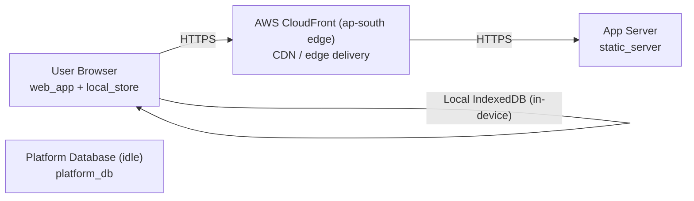

# Deployment Guide

> Maintained by QuorQ AI SDLC. Text between `sdlc:auto` markers is regenerated; anything outside them is yours and is kept.

<!-- sdlc:auto:start how-it-deploys -->
Pushes to `main` run `.github/workflows/deploy.yml`, which builds the API image (if there is a backend) and deploys the SPA to AWS Amplify. Commits touching only `docs/sdlc/**` don't deploy. Deployments can also be started from the platform's Deployment tab.
<!-- sdlc:auto:end how-it-deploys -->

<!-- sdlc:auto:start environments -->
| Name | Service | Runtime | Scaling | Environment |
|---|---|---|---|---|
| AWS CloudFront (ap-south edge) | CDN / edge delivery | AWS CloudFront | Managed edge, auto | dev |
| App Server | static_server | Node.js 20 / Express 5 (AWS App Runner or ECS) | 1 small instance (file serving only) | dev |
| User Browser | web_app + local_store | Modern mobile/desktop browser with IndexedDB and service worker | Per-device | dev |
| Platform Database (idle) | platform_db | Amazon RDS for PostgreSQL 16 | Smallest instance, idle | dev |
<!-- sdlc:auto:end environments -->

<!-- sdlc:auto:start live -->
_Not deployed yet._
<!-- sdlc:auto:end live -->

<!-- sdlc:auto:start topology -->

<!-- sdlc:auto:end topology -->
